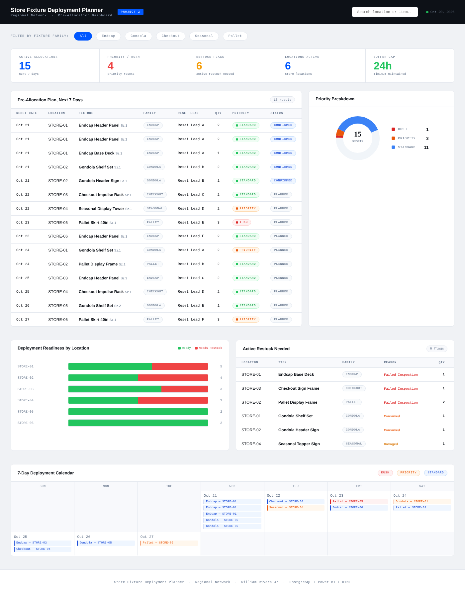

# Store Fixture Deployment Planner

> **Synthetic data.** All stores, reset leads, fixtures, and quantities in this project are fabricated for demonstration. Store and reset lead identifiers are coded and correspond to no real retailer, location, or person. No proprietary or employer data is used.

### PostgreSQL · Pre-Allocation · Deployment Readiness · Restock Tracking

A relational database project simulating how a distribution center plans reusable display fixtures across six stores. Endcaps, gondola sets, checkout racks, seasonal towers and pallet displays go out for store resets, come back to the DC, get inspected, and go out again. Built to demonstrate pre-allocation planning, inspection-based readiness tracking, and restock flag management using PostgreSQL.



---

## Background

Reusable fixtures are inventory too, and they only work if the right piece is clean, inspected, and at the right store before the reset crew shows up. Planning that well means pre-allocating fixtures to dated resets, tracking what is still out, and knowing what failed inspection before it is needed again.

The database tracks every stage of the fixture lifecycle: deployment to a store, retrieval, condition inspection, and redeployment, with a 7-day planning window and a 24-hour buffer between retrieval and the next deployment.

---

## Stack

- **PostgreSQL 15** - relational schema with 8 tables
- **DBeaver** - schema management and query execution
- **Docker Desktop** - containerized database environment

---

## Schema - 8 Tables

| Table | Description |
|---|---|
| `catalog` | 27 items: display fixtures and install kits across Endcap, Gondola, Checkout, Seasonal, and Pallet families with numeric size classes |
| `locations` | 6 stores + 1 central distribution center |
| `deployments` | Everything currently out at stores, with status (Active/Overdue) |
| `pre_allocations` | Fixtures assigned to upcoming store resets - the core planning table |
| `retrieval_schedule` | When deployed fixtures are coming back to the DC |
| `fixture_inspections` | Pass / Fail / Pending condition results per item after retrieval |
| `restock_flags` | Active Restock Needed flags - consumed, damaged, or failed inspection |
| `deployment_calendar` | 7-day deployment window with confirmed/planned status and 24-hour buffer tracking |

---

## Setup

### Run the database locally
```bash
docker run --name store_ops_db \
  -e POSTGRES_USER=your_user \
  -e POSTGRES_PASSWORD=your_password \
  -e POSTGRES_DB=store_ops \
  -p 5433:5432 \
  -d postgres:15
```

### Connect in DBeaver
```
Host:     localhost
Port:     5433
Database: store_ops
Username: your_user
Password: your_password
```

### Build the schema and load data
Run in order in DBeaver:
1. `sql/01_schema.sql`
2. `sql/02_seed_data.sql`

---

## Analytical Queries

| File | Query | What It Answers |
|---|---|---|
| `01_pre_allocation.sql` | Pre-Allocation Plan | Which fixtures are assigned to resets in the next 7 days, rush jobs first? |
| `02_deployment_readiness.sql` | Deployment Readiness Check | Is each upcoming reset Ready, Needs Restock, Inspection Pending, or Not Yet Inspected? |
| `03_active_restock_needed.sql` | Active Restock Needed | Which fixtures need to be replaced and why? |
| `04_deployment_calendar.sql` | 7-Day Calendar + Buffer Gap | Is there enough time between retrieval and the next deployment? |

---

## Key Findings

- **Endcap Base Deck at STORE-01** failed inspection with a confirmed reset in the window. Highest priority restock.
- **Gondola Header Sign at STORE-02** is still pending inspection for a confirmed reset. Risk of a same-day scramble.
- **Seasonal Display Tower at STORE-04** has a priority reset with no inspection completed yet.
- **6 items flagged Active Restock Needed** across 4 stores: 3 failed inspection, 2 consumed, 1 damaged.
- **All 15 deployment calendar entries** keep an adequate buffer. No same-day redeployment risk.
- **3 Priority resets and 1 Rush reset** in the 7-day window need attention first.

---

## Data Summary

| Table | Records |
|---|---|
| catalog | 27 |
| locations | 7 |
| deployments | 18 |
| pre_allocations | 15 |
| retrieval_schedule | 18 |
| fixture_inspections | 13 |
| restock_flags | 6 |
| deployment_calendar | 15 |

---

## Author

**William Rivera Jr**
Field Inventory Control Specialist & Data Analyst
Portfolio: [williamriverajr.com](https://williamriverajr.com)
LinkedIn: [linkedin.com/in/william-rivera-966230309](https://linkedin.com/in/william-rivera-966230309)
GitHub: [github.com/wriveraj](https://github.com/wriveraj)
